<p align="center">
  <picture>
    <source media="(prefers-color-scheme: dark)" srcset="design/wordmarks/portside-horizontal-dark.png">
    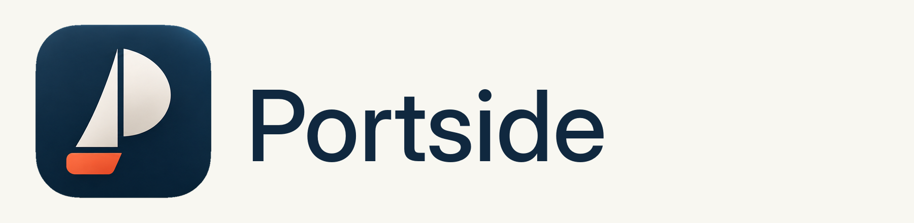
  </picture>
</p>

<p align="center"><b>The edges of your Mac, rebuilt to be fast.</b></p>
<p align="center">Dock, notch, menu bar, launcher and app switcher in one native app.</p>

<p align="center">
  
  
  
  
</p>

<p align="center">
  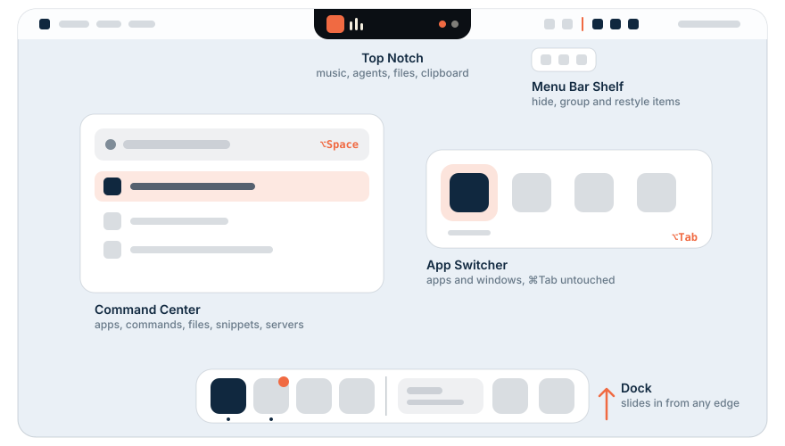
</p>

# Portside

Portside is a native macOS app (Swift, SwiftUI and AppKit) that replaces or extends the parts of macOS you touch all day. Every piece is event-driven: no polling, no focus stealing, no lag. Turn on only the parts you want.

## Install

| 1. Download | 2. Drag | 3. Stay current |
| --- | --- | --- |
| `Portside-X.Y.Z.dmg` from [Releases](https://github.com/jameszangari/portside/releases/latest) | Portside to Applications | Settings > Check for Updates |

Signed with a Developer ID and notarized. macOS asks for each permission only when a feature needs it ([what and why](#privacy)).

## Features

| | Surface | Open with | What you get | Status |
| --- | --- | --- | --- | --- |
| ⚓ | **Dock** | Touch a screen edge | A faster dock with widgets, groups and stacks | On |
| 🎵 | **Top Notch** | Hover the notch | Music, agents, meetings, files, clipboard, AirPods | Preview, off by default |
| 🧭 | **Menu Bar Shelf** | Click the menu bar icon | Hide, group and restyle menu bar items | Experimental |
| 🌈 | **Music visualizer** | Play a song | The menu bar glows, bounces or waves with the music | Off by default |
| 🤖 | **Agent status** | Start a coding agent | Claude Code, Codex, OpenCode, T3 Code and ChatGPT progress | With Agents widget or Top Notch |
| 🔎 | **Command Center** | ⌥Space | Search apps, commands, files, snippets and servers | Optional, off by default |
| 🔀 | **App Switcher** | ⌥Tab | Switch apps or windows, ⌘Tab left alone | Optional, off by default |

<table>
  <tr>
    <td width="50%">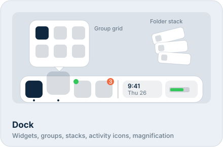</td>
    <td width="50%">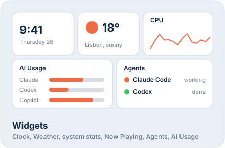</td>
  </tr>
  <tr>
    <td>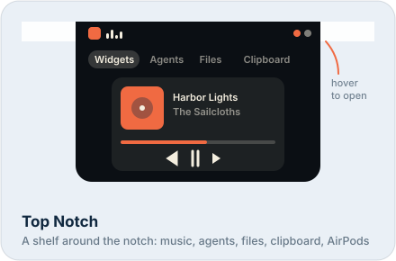</td>
    <td>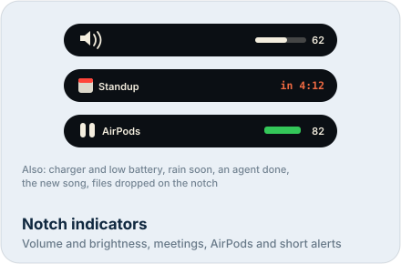</td>
  </tr>
  <tr>
    <td>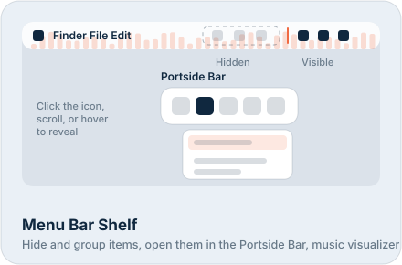</td>
    <td>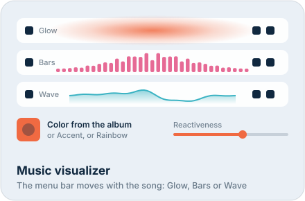</td>
  </tr>
  <tr>
    <td>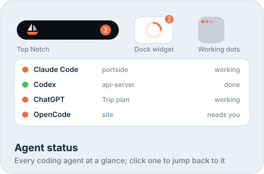</td>
    <td>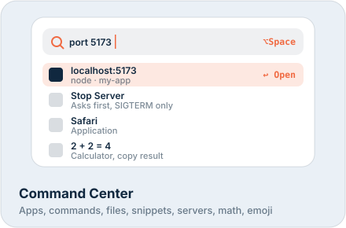</td>
  </tr>
  <tr>
    <td>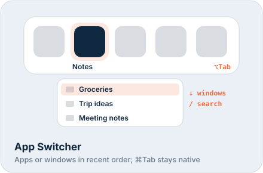</td>
    <td>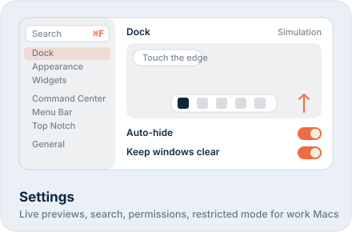</td>
  </tr>
</table>

Every detail: [docs/FEATURES.md](docs/FEATURES.md). Short lists per surface below.

<details>
<summary><b>⚓ Dock</b></summary>

- Reveal starts within a frame of touching the edge. Bottom, Left or Right, on every display.
- Pin, reorder, drag out to remove, drop files on apps. Running and recent apps, badges, native tile menus.
- Activity icons: camera, microphone, playing audio, and "working" dots for busy apps and coding agents.
- **Widgets:** Clock, Battery, Calendar, Weather, System Stats, CPU, Memory, Now Playing (with album art), Agents, AI Usage (Claude, Codex, Copilot). Small, Wide or Extra Wide.
- **Groups and stacks:** app groups with grids and custom icons, folder stacks (grid, fan or list), network shares, web links, Trash.
- **Appearance:** Liquid Glass or solid backgrounds, magnification, icon size and gap, one color picker everywhere.
- **Plays well with macOS:** maximized windows stop at a pinned dock, Mission Control and App Exposé push it aside, VoiceOver reads every tile.
- **Hide the macOS Dock:** saves your settings and puts them back on quit, even after a crash. Imports your native Dock apps and folders.

</details>

<details>
<summary><b>🎵 Top Notch</b></summary>

A shelf around the notch (inside the menu bar on displays without one).

| Strip | Hover cards | Open shelf |
| --- | --- | --- |
| Album art and playing animation, agents, meeting countdown | Music with seeking (pin it to keep it open), agents, alerts | Widgets, Agents, Files, Clipboard, AirPods tabs |

| Indicators | Alerts |
| --- | --- |
| Volume and brightness level, replacing the macOS one | Meeting soon (with Join), agent done, charger, low battery, rain soon, AirPods connected, new song |

Also: drop files on the notch to hold them (with an AirDrop card), hotkeys to open the shelf or search the clipboard. Settings shows a live preview of each part.

</details>

<details>
<summary><b>🧭 Menu Bar Shelf</b> (experimental)</summary>

| | macOS 26 | macOS 27 (install in `/Applications`) |
| --- | --- | --- |
| Hide items | Everything left of a divider | Per app, with Visible, Hidden and Always Hidden |
| Portside Bar | Yes | Yes: open hidden items without revealing them |
| Groups, saved order, profiles | Groups | Yes |
| Reveal | Click | Click, scroll, hover or shortcut |

Also: style the menu bar and Portside Bar (full bar, split at the notch, or pills; glass, frosted or color) and an iPhone Live Activities switch. Hand checks are still open, see the [interaction audit](docs/research/P2-MENU-06-interaction-audit.md).

</details>

<details>
<summary><b>🌈 Music visualizer</b></summary>

The menu bar's background moves with the song (Settings > Menu Bar > Music).

| Style | Looks like |
| --- | --- |
| Glow | A wash that breathes with the loudness |
| Bars | A spectrum mirrored from the middle, bass in the center |
| Wave | A smooth line that follows the bass, mids and treble |

- Color from the album cover, your accent, or a rainbow. Intensity and Reactiveness (Calm to Lively) sliders.
- Fits the menu bar's shape, or spans the whole bar. The bar can also change shape and look while music plays.
- Listens only to the playing app, with System Audio Recording. Nothing is recorded. Without it, a steady pulse.
- Up to 30 frames a second only while music plays; gone 1.5 s after it stops. Still under Reduce Motion.

</details>

<details>
<summary><b>🤖 Agent status</b></summary>

| Where | What you see |
| --- | --- |
| Top Notch | Portside's sailboat (or a wheel, boxes or dots) while agents work, a count, an alert when one is done or needs you |
| Dock widget | Provider icon with a spinning ring, a count badge, a check when done |
| App icons | Working dots on T3 Code, Claude and Codex while their agents run |

- Works with Claude Code, Codex, OpenCode, T3 Code (including Cursor in T3) and ChatGPT chats.
- Click an agent to jump to its exact Terminal or iTerm tab, or its window.
- Claude Code and Codex CLI need Agent Hooks once (Settings > Widgets), which back up your files first.

</details>

<details>
<summary><b>🔎 Command Center</b></summary>

One keyboard-first panel that never leaves the current app.

| Built in | Optional modules |
| --- | --- |
| Apps, Portside commands, Settings panes, quicklinks, snippets, calculator (`2+2`), emoji (`:rocket`) | Apple Shortcuts, other apps' menu bar items, file names in folders you pick, encrypted clipboard history, Local Servers |

**Local Servers** lists the TCP servers your account runs: search by port, copy the address, open it, or stop it after you confirm. With Local Intelligence on, ask "What's using port 5173?" and Apple's on-device model reads the question. No cloud.

</details>

<details>
<summary><b>🔀 App Switcher</b></summary>

- Drawn like ⌘Tab, over running apps in recent order. Tap ⌥Tab to flip between the last two.
- ↓ picks a window. Window-first mode shows one row per window. `/` searches titles.
- Optional window previews (Screen Recording). Portside never takes focus.

</details>

<details>
<summary><b>⚙️ Settings and support</b></summary>

- Search every pane (⌘F). Changes apply live, with a simulation or live preview for the Dock, App Switcher, Command Center, menu bar and Top Notch.
- General > Permissions: live status of each grant, Reset All Permissions, restricted mode for work Macs.
- Portside's own icon in System, Navy, Dark or Light.
- Daily update checks, in-place install from the signed release.
- Copy Diagnostics and Export Debug Report for bug reports (no app names or personal data).
- Global hotkeys: Settings ⌘⇧D, Command Center ⌥Space, App Switcher ⌥Tab.

</details>

## Planned

- **Command Center and App Switcher:** more optional tools, an optional ⌘Tab replacement, Dock hover window previews.
- **Developer tools:** project-aware server manager, smart workspaces, agent supervisor, optional local-only AI.
- **Menu bar:** reliable hiding from any install location, saved-order restore, per-item overflow, full parity on macOS 27.
- **Dock:** keyboard navigation, side-dock widget layout, profiles, Trash Option-click Empty, plain file tiles from the native Dock.

Order and scope: [Portside 2.0 roadmap](docs/ROADMAP_2_0.md) and [implementation plan](docs/IMPLEMENTATION_PLAN_2_0.md). Open hand checks: [docs/CHECKLIST.md](docs/CHECKLIST.md).

## Privacy

<p align="center">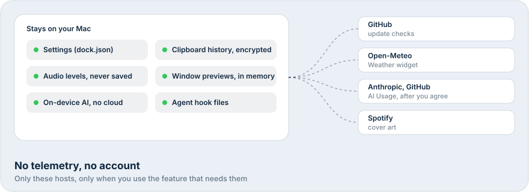</p>

No telemetry, no account. Nothing leaves your Mac except the requests below, and only when you use the feature.

| Sends to | Only when | What |
| --- | --- | --- |
| GitHub | Update checks | Version check, release download |
| Open-Meteo | Weather widget | Your city, then its coordinates |
| Anthropic | AI Usage with Claude, after you agree | Claude Code's token, to read your usage |
| GitHub | AI Usage with Copilot, after you agree | GitHub CLI's token, to read your quota |
| Spotify | Now Playing with Spotify | A cover art request |

| Permission | Used for |
| --- | --- |
| Accessibility | Window fitting, native tile menus, App Switcher windows, menu bar items, volume keys |
| Screen Recording | App Switcher window previews (off by default) |
| System Audio Recording | Music visualizer and measuring real playback (levels only, never saved) |
| Calendar | Calendar widget, meeting countdown |
| Bluetooth | Live AirPods levels (off by default) |
| Automation | Finder Trash, Open at Login, Now Playing, raising agent terminals |
| Notifications, Full Disk Access, Keychain | Update alerts, protected folders, clipboard history key |

Files written, what each widget reads, and how Local Servers stays safe: [docs/PRIVACY.md](docs/PRIVACY.md).

## Build from source

Needs macOS 26+, Apple Silicon and the Xcode command line tools. No Xcode project, no signing identity.

```sh
source scripts/swift-env.sh
swift build
swift run portside
```

| Task | Command |
| --- | --- |
| `.app` bundle (ad hoc signed) | `SIGN_IDENTITY=- scripts/build-app.sh` then `open build/Portside.app` |
| Stream logs | `log stream --level info --predicate 'subsystem == "com.james.portside"'` |
| Restore the native Dock | `swift run portside --restore-dock` |
| Debug report | `portside --dump-debug` |

Signing, DMG and releases: [docs/BUILD.md](docs/BUILD.md). How it works inside: [docs/ARCHITECTURE.md](docs/ARCHITECTURE.md).

## Docs

| Using Portside | Contributing | Planning |
| --- | --- | --- |
| [Features](docs/FEATURES.md) | [CONTRIBUTING](CONTRIBUTING.md) | [Roadmap 2.0](docs/ROADMAP_2_0.md) |
| [Privacy](docs/PRIVACY.md) | [Architecture](docs/ARCHITECTURE.md) | [Implementation plan](docs/IMPLEMENTATION_PLAN_2_0.md) |
| [Security](SECURITY.md) | [Build and release](docs/BUILD.md) | [Architecture 2.0](docs/ARCHITECTURE_2_0.md) |
| [Brand](design/README.md) | [Settings file](docs/DATA.md) | [Test matrix](docs/TEST_MATRIX_2_0.md) |
| | [Checklist](docs/CHECKLIST.md) | [Original plan](docs/PLAN.md) |

## License

[MIT](LICENSE). Provided as is, with no warranty. Portside can move and resize windows, change the macOS Dock's auto-hide settings, edit menu bar preferences and edit your agent hook files when you turn those features on. Read [Privacy](docs/PRIVACY.md) first.
