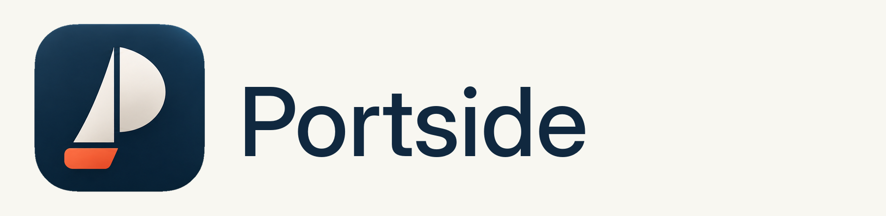

<p align="center">
  <picture>
    <source media="(prefers-color-scheme: dark)" srcset="design/brand/wordmarks/portside-horizontal-dark.png">
    
  </picture>
</p>

<p align="center"><b>A dock that's already there when you reach for it.</b></p>

<p align="center">
  
  
</p>

# Portside

A fast, event-driven dock replacement for macOS, written in Swift (SwiftUI and AppKit) and built with SwiftPM. Touch the edge and it starts sliding in within a frame. Move away and it gets out of the way. No polling, no focus stealing, no lag.

Brand: the approved sail identity lives in [`design/brand/`](design/brand/README.md), with a two-page [brand guide](design/brand/presentation/portside-approved-identity-v2.pdf).

Portside is a personal project for macOS on Apple Silicon. It builds into a locally signed .app but is not notarized or meant for general distribution.

## Features

**Reveal and hide**
- Edge reveal driven by an `NSTrackingArea` on a thin edge window. No polling timers in the reveal/hide path.
- Non-activating panel: the first click works and the frontmost app keeps focus.
- Animated slide with a configurable duration, an instant option, and Reduce Motion support.
- Cancelable one-shot hide delay, canceled on re-entering the edge zone, the panel, or an open group grid.
- Dragging a file to the edge reveals the dock, and it stays up while the drag is over it. Hides with the normal delay after the drop or when the drag leaves.
- Timing logs for mouseEntered (or draggingEntered), animation start, and panel-interactive.
- Auto-hide toggle (menu bar item, separator right-click menu, Settings, or Cmd+Option+D). With hiding off, the dock stays revealed.
- Multi-display: an edge zone on every screen; the dock follows the display whose edge you hit. Works across Spaces and over fullscreen apps. Does not reveal while you are holding a mouse button (for example dragging a window); file drags to the edge still reveal.
- Notification badges, the same ones the macOS Dock shows, with no permission needed. They update while the dock is visible. Same size, placement, font and red as the native badge. Badge color is a setting (Appearance > Badges: macOS Red, Accent Color, system colors, or Custom). Toggle in Settings. Group tiles show the sum of member badges.

**Apps**
- Pinned apps with running indicators, updated from `NSWorkspace` notifications.
- Drag to reorder. Drag an .app from Finder onto the strip to pin it (a tile-sized insertion gap opens at the drop slot, same as folders).
- Drag an icon out of the dock to remove it, like the native Dock: the icon floats under the cursor for the whole drag (strip leaves a gap), a "Remove" label shows once it is clearly outside, and releasing it there removes it with a short poof (instant under Reduce Motion). Dragging back over the dock reorders as usual, and Escape puts it back. Works for app tiles, group tiles, and widgets (a group with apps in it asks first, see Groups); an app dragged out of an open group grid asks Remove from Group or Remove from Dock.
- Drop files on an app tile to open them in that app, like the native Dock. Only tiles whose app can open the files highlight and accept the drop (Finder takes folders). A not-running pinned app launches with the bounce.
- Running apps that are not pinned show after the pinned section.
- Right-click menu: Keep in Dock or Remove from Dock, Add to Group, Open at Login (checkbox), Show in Finder, then for running apps Hide (Show if hidden) and Quit. Hold Option and Quit becomes Force Quit. Open at Login for other apps uses System Events (may ask for Automation once); Portside's own tile uses the same SMAppService path as Settings.
- App tiles, group tiles, Portside's own tile and group cells: short click opens (or toggles the group); hold for 0.5s opens its menu (simultaneous with the tap, not exclusive); moving first starts a drag. Hover labels track the magnified icon's spring frames so they stay centered.
- Dock menus take the keyboard while open (Escape closes them, arrows move through them) without taking focus from the frontmost app.
- Separator right-click menu: Turn Hiding On/Off, Turn Magnification On/Off, Position on Screen (Left, Bottom, Right, checkmark on the current one), Add Spacer (Regular / Small), Dock Settings, Quit Portside.
- Spacers: empty gaps between pinned apps (like native Dock spacer tiles). Reorder by drag; drag out or Remove Spacer to delete. Imported from the macOS Dock on first launch and via Import.
- The app menu opens above the icon (beside it on the side docks), like the native Dock.
- Native Dock modifier clicks on app tiles and group grid cells: Cmd-click reveals the app in Finder (no launch), Option-click switches to the app and hides the one that was frontmost, Cmd+Option-click switches and hides all other apps. Portside itself is never hidden.
- Native-style launch bounce for pinned apps on any edge (sideways on the side docks) and for apps opened from a group grid (optional, off under Reduce Motion).
- Hover labels in a reusable non-activating overlay panel, styled as a speech bubble with a tail pointing at the icon, like the native Dock, using the dock's own background (style, frost and tint).
- "Add App to Dock..." from the menu bar item.

**Layout**
- Bottom, Left, or Right position, switchable live.
- Drag the separator to resize icons live (clamped to what fits, persisted).
- Icon gap (0 to 8pt, default 6) between tiles, live in Settings; same gap on side docks. At 0, every item keeps the app-icon minimum spacing; separator air tracks the gap (5pt plus the gap per side).
- Magnification on every position: app and group tiles grow under the cursor with a smooth falloff to their neighbors, away from the screen edge (up on the bottom, sideways on the sides), past a shelf that keeps its thickness while it lengthens. Near the ends of a long dock the shelf stays on screen. Widgets and separators keep their size. Magnified size 16 to 128pt, set live in Settings. Hold Control-Shift over the dock to flip it for a moment. Labels, right-click and press-and-hold follow the magnified icon, and a launch bounce plays at the magnified size. Off during drags and while a group grid or menu is up. Under Reduce Motion the size follows the cursor without the spring.

**Widgets**
- Clock, Battery, Calendar, Weather, System Stats.
- Enable, disable, and reorder in Settings, or toggle from the menu bar item.

**Groups**
- User-defined groups of apps shown as one tile that opens a grid.
- Inline naming on creation; rename from the open grid title (click it), the tile menu, or Settings. Ungroup and remove-from-group from context menus.
- Removing a group that has apps ("Remove from Dock", or dragging its tile out) asks first: Ungroup Instead (default, apps return as normal tiles), Remove Group, or Cancel. Empty groups go without asking. The alert gives focus back to the previous app.
- Optional open on hover, with configurable open delay and close grace.
- Dragging a file or app over a group tile opens its grid immediately. Drop an app from Finder, or drag a dock app (pinned or unpinned running) onto the tile or into the grid to add it (a dashed tile-sized gap follows the cursor so you choose the slot). Drop a file on a member that can open it (it highlights) to open it there. The grid closes when the drag leaves both the tile and the grid.
- Resting a file drag on a running app tile for about 600ms brings that app forward (native spring-load).
- Drag a member inside the open grid to reorder it. Dragging a member out asks Remove from Group (stays on the dock next to the group) or Remove from Dock, or Cancel.

**Appearance**
- Icons match the macOS icon style (Default, Dark, Clear, Tinted) like the native Dock, and refresh when you change it in System Settings. Or pick "Original" to show each app's own artwork.
- Dock background: Liquid Glass (macOS 26 and later, the default), Frosted, or Solid, with a Frost (or Opacity) slider, an optional tint color, and corner radius. Open group grids use the same look. Widgets keep their own frosted card whatever the Frost setting. Accessibility Reduce Transparency turns glass into opaque frosted live; Reduce Motion is respected for slides, springs, and the poof.

**Folder stacks**
- Filesystem folders pin in the right section (after widgets, before Trash), separate from app groups. Drag a folder from Finder onto the dock to add one (an insertion gap opens at the drop slot, like the native Dock); reorder among stacks; drag out or Remove from Dock to unpin.
- Tile shows a mini grid of the folder's contents (folder icon when empty, or always with Display as Folder). Click opens the stack as a Grid, Fan, or List; click an item to open it. Fan curves up from the tile with a name beside each icon (first 10, then "N more in Finder"). Menu: Open, Show in Finder, View as, Sort by, Folders First, Show Hidden Files, Display as Folder, Remove from Dock. The open stack's ... button has the same view, sort, and filter choices. Settings are per stack.
- Sort by Custom Order (default: name, plus the slots you drop items into), Name, Date Added, Date Modified (newest first), or Kind. Drops choose a slot only in Custom Order with Grid or List; otherwise the item just lands in the folder.
- Drop files or apps onto a stack (or into its open grid) to move them into the folder (copy if move fails). Dragging over a stack tile opens its grid immediately. In the open grid, an insertion gap follows the cursor so you choose the slot; order is kept in dock.json. Contents update via FSEvents (no polling).
- Native Dock folder tiles from `persistent-others` import on first launch and via Import from macOS Dock, with their view (fan, grid, list), sort (name, date added, date modified, kind), and Display as Folder choice. Plain file tiles are still skipped.

**Trash**
- Trash stays at the far end on Bottom, Left, and Right, with native empty/full icons, magnification, and a hover label. "Show Trash in dock" (General > Dock) applies live and defaults on.
- Click opens Finder's Trash. Right-click or hold for Open and Empty Trash. Emptying asks for confirmation in Finder; empty or unreadable Trash disables the command.
- Drop files and folders from Finder to move them to the Trash. Dragging a dock tile onto Trash asks first: Remove from Dock, Move to Trash (apps and folder stacks), or Cancel. State updates use directory events, with no polling.
- Empty/full icon: prefers listing `~/.Trash` (Full Disk Access). If that is denied, uses Finder's trash count when Automation is already allowed. FSEvents watches the Trash folder (works without Full Disk Access). If neither read path works, the icon stays empty and a dismissible Settings hint links to Full Disk Access. Drops optimistically flip to full; Empty Trash flips to empty, then the watcher confirms.
- Empty Trash needs Automation permission for Finder. Denial and file-operation failures appear inline in Settings and in the Trash hover label. Under `swift run`, macOS may attribute permissions to the launching terminal; use the built app for permission testing.

**Settings window**
- System Settings-style layout: a sidebar with General, Appearance, Widgets, Groups, and System panes, and the selected pane on the right. Changes apply live.
- Fixed 760 x 560 window (wide and short); long panes scroll instead of growing the window. Always opens centered on the primary display (same spot every time).
- Sidebar shows the Portside icon and version (`v0.2.0`; hover for author and build hash) and a Check for Updates button.
- Drag widget rows to reorder them.

**Native Dock**
- "Hide the macOS Dock" (Settings > System): keeps the native Dock from ever appearing while Portside runs, using the autohide-delay trick. Its exact prior settings are saved first and restored when you turn this off, quit, or stop Portside with Ctrl+C or `kill`. After a crash or `kill -9`, the next launch restores them first.
- First launch (no `dock.json`): pinned apps, folder stacks, position, and icon size are taken from the native Dock (Finder first). If a Hide-the-Dock backup exists, position and size come from it instead of the live values.
- "Import from macOS Dock..." (Settings > System > Import): a confirmation sheet shows what was found. Add missing apps (appended, nothing reordered) or replace the apps (groups and widgets stay; stacks merge or replace with apps), and optionally take the native position and icon size. Apps no longer on disk, spacers, and non-folder other tiles are skipped; folder stacks from `persistent-others` import. Your dock is copied to `dock.json.before-import` first, and "Undo last import" restores it. Read only: nothing in `com.apple.dock` is written.
- "Restore macOS Dock" in the menu bar item, and `portside --restore-dock` (restores from the backup and exits, no UI).

**Branding**
- Liquid Glass app icon compiled from the Icon Composer document (`design/brand/icon-composer/AppIcon.icon`). It follows the system icon style (light, dark, tinted) in Finder and the native Dock, and Portside's own dock tile, Settings header, alerts, and About panel use the same system-rendered icon, so it matches the size and look of every other app. Under `swift run` the icon is borrowed from a built `Portside.app` when one exists.
- Menu bar item uses the sail mark as a template image, so it follows light, dark, and tinted menu bars.
- "About Portside" in the menu bar item: the standard About panel with the version, author, and repo link.

**App bundle and startup**
- `scripts/build-app.sh` builds a signed `build/Portside.app` with the brand icon, version from `VERSION`, and the Calendar / Finder / System Events Automation usage strings. `--install` copies it to `~/Applications`.
- "Open Portside at login" (Settings > System > Startup) through `SMAppService`. macOS is the source of truth; the toggle shows its real status, links to Login Items when approval is needed, and is disabled under `swift run`.

## Planned

From `docs/CHECKLIST.md` Remaining backlog:
- Milestone F leftover: import plain file tiles from `persistent-others` (folders already import).
- P3 leftovers: window list in the app menu; VoiceOver / keyboard navigation.
- Side-dock widget layout; window previews on hover; profiles; update checker; Trash Option-click Empty and icon animation.

## Requirements and build

- macOS 14 or later (`Package.swift` targets `.macOS(.v14)`). Developed on macOS 27 with Xcode 27 on an M4 Max.
- Swift toolchain with `swift-tools-version` 5.10 support (Xcode command line tools are enough).

```
swift build
swift run portside
```

Restore the native Dock from the backup without starting the app:

```
swift run portside --restore-dock
```

View logs while it runs:

```
log stream --level info --predicate 'subsystem == "com.james.portside"'
```

## Build the app

```
scripts/build-app.sh            # builds build/Portside.app
scripts/build-app.sh --install  # also copies it to ~/Applications/Portside.app
open build/Portside.app
```

- Runs `swift build -c release`, then assembles `Contents/MacOS/portside`, `Contents/Info.plist` (from the repo's `Info.plist` plus bundle keys and the version from `VERSION`), the app icon, and the SwiftPM resource bundle with the brand PNGs (in `Contents/Resources`, covered by the signature). The icon is `design/brand/icon-composer/AppIcon.icon` compiled by `xcrun actool` into `Assets.car` (Liquid Glass, `CFBundleIconName`) plus a flat `AppIcon.icns` for older macOS. If actool fails it prints why and copies `design/brand/approved-icon/icns/` instead; if that is missing too, the hidden `portside --export-icon <path.png>` flag renders one. No network.
- `--install` copies to `~/Applications/Portside.app`, never `/Applications`. It refuses while that copy is running; quit Portside first. Without the flag nothing is installed.
- Signing is ad-hoc by default. Ad-hoc signatures change on every build, so macOS may ask for Calendar permission again after each rebuild, and may treat each build as a new login item. To avoid that, create a self-signed code signing certificate in Keychain Access (Certificate Assistant > Create a Certificate, type Code Signing) and build with `SIGN_IDENTITY="Your Cert Name" scripts/build-app.sh`.
- Turn on "Open Portside at login" from the copy you keep (normally `~/Applications/Portside.app`). macOS remembers the path it was registered from.
- `swift build` and `swift run portside` are unchanged and still work for development.

Restore the native Dock from the bundle's binary:

```
build/Portside.app/Contents/MacOS/portside --restore-dock
~/Applications/Portside.app/Contents/MacOS/portside --restore-dock
```

## Versioning and releases

- `VERSION` at the repo root is the single source of truth. Edit the version only there (or let the release script do it).
- `scripts/gen-version.sh` writes `Sources/portside/BuildInfo.swift` (generated, committed) with the version, short git hash, and dirty flag. Run it to refresh the hash before a build.
- Cut a release with `scripts/release.sh patch|minor|major`. It is a dry run by default; add `--apply` to bump `VERSION`, make one "Release vX.Y.Z" commit, and create an annotated tag. It refuses on a dirty tree and never pushes; it prints the `git push` and `gh release create` commands to run.
- Tags use the `vX.Y.Z` format. The future update checker compares the latest release tag against this version.

## How it works

- `EdgeTracker` owns a thin, near-invisible window along the chosen screen edge. An `NSTrackingArea` on it reports `mouseEntered` and `mouseExited`, so reveal starts the moment the window server delivers the event. It is also a drag destination for files, since tracking areas are unreliable during another app's drag.
- `DockPanel` is a non-activating `NSPanel` that slides in from the edge. It has its own tracking area so hovering it cancels the hide timer.
- `DockEngine` coordinates both. The only timers are the one-shot hide delay, widget refresh, and group hover/close/spring-load delays, none of which poll.
- `OverlayPanel` is a second non-activating panel used for hover labels, group grids, and the drag-out "Remove" label. It sits outside the strip so its content can extend past the strip's bounds.

## Where data lives

Settings and the dock layout are saved as JSON at:

```
~/Library/Application Support/com.james.portside/dock.json
```

Before each "Import from macOS Dock", the previous layout is copied to `dock.json.before-import` in the same folder (overwritten by the next import, deleted by "Undo last import").

While "Hide the macOS Dock" is on, the native Dock's prior settings are backed up at:

```
~/Library/Application Support/com.james.portside/native-dock-backup.json
```

It is deleted after a verified restore. If it exists when Portside starts, Portside restores from it first.

The Settings window controls:
- Position, auto-hide, icon size, icon gap (`iconGap`, points, 0 to 8, default 6), "Animate opening applications"
- Show Trash in dock (`showTrash`, default `true`); dismissed Full Disk Access hint (`trashAccessHintDismissed`, default `false`)
- Show notification badges (`showBadges`, default `true`); badge color (`badgeColor`: `macOS`, `accent`, `orange`, `yellow`, `green`, `blue`, `purple`, `pink`, `graphite` or `custom`, default `macOS`); custom badge color (`badgeCustomColor`, sRGB `{ red, green, blue, alpha }`, used when `badgeColor` is `custom`)
- Folder stacks (`stacks`: `{ id, path, itemOrder?, view?, sort?, foldersFirst?, showHidden?, showAsFolder? }[]`, right section before Trash; `itemOrder` is child filenames for Custom Order placement; `view` is `grid` (default), `fan`, or `list`; `sort` is `manual` (default), `name`, `dateAdded`, `dateModified`, or `kind`; the rest are written only when on)
- Magnification (`magnificationEnabled`) and Magnified size (`magnifiedSize`, points, 16 to 128, default 64)
- Reveal delay, hide delay, animation duration (with reset to defaults)
- Widgets: on/off and order
- Groups: rename, ungroup, delete, open on hover, open delay, close grace
- Appearance: icon style (`iconStyle`: `matchSystem` or `original`), background (`backgroundStyle`: `glass`, `frosted`, or `solid`), `backgroundFrost` (0 to 1), `backgroundTint` (sRGB `red`, `green`, `blue`, `alpha`; absent when off), `cornerRadius` (points)
- Hide the macOS Dock (`hideNativeDock`, plus `nativeDockExplained` once the first-time dialog was confirmed)
- Import from macOS Dock and Undo last import (nothing new stored in `dock.json`; imported apps, spacers, position, and icon size land in `entries`, `edge`, and `iconSize`). Entries may include `{ type: "spacer", spacer: { id, size } }` (`regular` or `small`).
- Open Portside at login: not stored by Portside. macOS keeps it (System Settings > General > Login Items).

The built app lives at `build/Portside.app` (ignored by git), and at `~/Applications/Portside.app` after `scripts/build-app.sh --install`.

## Notes

- The separator's resize cursor needs a private SkyLight call, because macOS ignores cursor changes from a background app. `BackgroundCursor.swift` loads it with `dlopen`/`dlsym`. If the framework or symbols are missing, the cursor feature is disabled and nothing crashes.
- Notification badges read each app's badge from LaunchServices (`_LSASNCreateWithPid`, `_LSCopyApplicationInformationItem`), the store the Dock itself draws from. `LaunchServicesBadges.swift` loads them with `dlopen`/`dlsym`; if they are missing, badges turn off and Settings says so. No other private APIs are used.
- The native Dock is modified only while "Hide the macOS Dock" is on: Portside writes `autohide` and `autohide-delay` in `com.apple.dock` (public CFPreferences, then `killall Dock`) and restores every saved value on the way out. With the option off, no `com.apple.dock` settings are touched and both docks can react to the same edge. Portside is separate from the third-party Dockset app.
- The system's Cmd+Option+D shortcut toggles the native Dock's auto-hide. While Portside hides the native Dock, it makes the native Dock appear until restore.
- Opening Settings turns Portside into a regular app (visible in Cmd+Tab and the native Dock) until the window closes.
- Cmd+Option+D may conflict with the system's own "Turn Dock hiding on/off" shortcut. Disable that one in System Settings to use Portside's.

## Project layout

```
Sources/portside/
  PortsideApp.swift         Entry point (--restore-dock, --export-icon, crash recovery, signals), menu bar, About panel, app delegate
  DockEngine.swift          Coordinator for tracker, panel, hide timer, and model
  EdgeTracker.swift         Per-screen edge windows with NSTrackingArea (event-driven reveal)
  DockPanel.swift           Non-activating NSPanel, slide animation, panel tracking, multi-display relocate
  DockModel.swift           Codable settings and entries, persistence to dock.json
  DockEdge.swift            Bottom/Left/Right enum and DockScreen (active display)
  DockStrip.swift           SwiftUI strip: tiles, widgets, separator, reorder, drops
  DockItem.swift            App tile, icon cache, launch/activate
  DockBadges.swift          Notification badges: visible-only reads and the badge chip
  LaunchServicesBadges.swift Private LaunchServices badge reader (dlopen/dlsym guarded)
  TileActions.swift         Modifier clicks (Cmd, Option) and the AppKit right-click menu with Force Quit
  AppLoginItem.swift        Open at Login checkbox: SMAppService for Portside, System Events for other apps
  FileDrop.swift            Per-drag state for pin apps/folders, open, deposit, and Trash drops
  AppSpringLoad.swift       File drag resting on a running app brings it forward
  Trash.swift               Native Trash tile, directory watcher, Finder actions
  TrashDrop.swift           Confirm when a dock tile is dropped on Trash
  FolderStack.swift         Folder stack model and FSEvents contents
  StackController.swift     Stack open/close, drag-open, deposit into folder
  StackViews.swift          Stack tile and grid popover
  DragOut.swift             Drag an item out to remove it: "Remove" label, poof, Escape
  DockHover.swift           Hover target frames and label placement
  Magnifier.swift           Dock magnification: per-tile scale and shift from the cursor, shelf widening, panel room
  FolderGroup.swift         Group, spacer, and entry models
  GroupController.swift     Group open/close state and every close path
  GroupRemoval.swift        "Remove group?" confirmation alert and focus hand-back
  GroupViews.swift          Group tile and expanded grid views
  OverlayPanel.swift        Reusable non-activating overlay panel
  LaunchBounce.swift        Native-style launch bounce animation
  RunningApps.swift         Running app tracking via NSWorkspace notifications
  NativeDock.swift          Native Dock hide/restore: prefs backup, writes, Dock restart, verify
  NativeDockController.swift  "Hide the macOS Dock" toggle, first-time dialog, alerts
  NativeDockImport.swift    Reads the native Dock (apps, position, size) and the import sheet
  LaunchAtLogin.swift       "Open Portside at login" via SMAppService.mainApp
  SettingsWindow.swift      Settings window: sidebar and panes (General, Appearance, Widgets, Groups, System)
  DockAppearance.swift      Icon style and dock background options, background modifier, icon style observer
  HotKey.swift              Global hotkey through Carbon RegisterEventHotKey
  BackgroundCursor.swift    Guarded SkyLight call for the resize cursor
  AppIcon.swift             App icon: system-rendered in Portside.app, bundled PNGs under swift run, PNG export
  BrandAssets.swift         Safe resource bundle lookup (no Bundle.module), menu bar template icon
  AppInfo.swift             App name, author, version line, and repo URL
  BuildInfo.swift           Generated by scripts/gen-version.sh: version, git hash, dirty flag
  UpdateChecker.swift       Update check (stub until GitHub releases are wired up)
  WidgetProtocol.swift      Widget plugin protocol and sizes
  WidgetHost.swift          Widget lifecycle and refresh timer
  Widgets/
    ClockWidget.swift       Time and date
    BatteryWidget.swift     Battery percent and charging state
    CalendarWidget.swift    Date and next event
    WeatherWidget.swift     Temperature and conditions (Open-Meteo)
    SystemStatsWidget.swift CPU and memory usage
  Support/                  Bundled resources: AppIcon-<px>.png (actool's flat render of AppIcon.icon) and MenuBarIcon-<px>.png
Sources/AppLoginItemList/   C helper: read session Open at Login list (LSSharedFileList)
scripts/
  gen-version.sh            Writes BuildInfo.swift from VERSION and git
  release.sh                Bumps VERSION, commits, and tags a release
  build-app.sh              Builds and signs build/Portside.app (--install to ~/Applications)
  check-tile-input.swift    Synthetic Accessibility check: clicks, hold menu, label centering
design/brand/               Approved Portside sail icon, wordmarks, menu bar assets, and tokens; see its README
```
