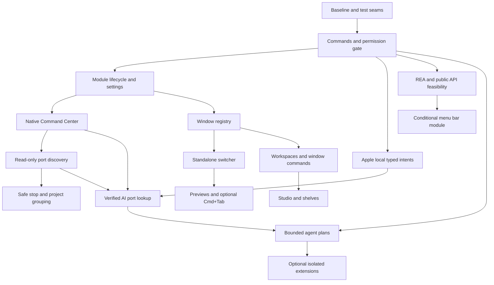

# Portside 2.0 implementation plan

Proposed backlog, 2026-11-06. [Roadmap](ROADMAP_2_0.md) · [Architecture](ARCHITECTURE_2_0.md) · [Test matrix](TEST_MATRIX_2_0.md) · [REA research](REA_RESEARCH_2_0.md)

## Working agreement

All `P2-*` IDs below are **not started**, unless explicitly called out as a planning artifact. They are stable local planning IDs, not created GitHub issues. One chunk means one behavior, its failure path, focused tests and docs in one PR. Aim for roughly half a day to two days of implementation; estimates are sizing guidance, not deadlines. If a spike cannot resolve its question in two days, publish evidence and unknowns, then split the follow-up. Do not fold unrelated backlog cleanup into the same PR.

Every implementation PR must: name IDs and dependencies; preserve existing defaults; include off/denied/unavailable behavior; pass the relevant [test rows](TEST_MATRIX_2_0.md); record build/launch and physical tests separately; update CHECKLIST plus current architecture/data/features docs where code changed. Use a feature branch and PR, never push directly to protected `main`. Release numbers are gates, not a mandate to bump VERSION during development.

## Dependency map



REA spikes are scoped research prerequisites for the relevant feature, not a reason to wait on every competitor before implementing core services. Native UI work does not depend on AI. Optional runtime adapters do not gate the Apple slice. Workspace work does not depend on menu bar success.

## Phase 0: core and stability

| ID | Small chunk / implementation boundary | Depends on | Acceptance criteria |
| --- | --- | --- | --- |
| P2-CORE-01 | Baseline fixtures and SwiftPM test seam; inventory current probes and hand gaps | Baseline | Build and isolated launch recorded; a meaningful settings fixture test runs in SwiftPM without changing app targets unnecessarily; reveal/no-focus and native Dock recovery checks have reproducible procedures |
| P2-CORE-02 | `CommandRegistry` descriptors and read-only executor; adapt Open Settings as first command | CORE-01 | Duplicate IDs rejected; typed input validated; unavailable command returns a reason; cancellation/result delivered once; existing Settings route still works |
| P2-CORE-03 | `PermissionGate` with AX and app-level scope adapters | CORE-02 | No startup prompt; denied/revoked capability blocks handler; request occurs only from explicit action; existing UsageConsent remains independent; test revoked-between-check-and-execute |
| P2-CORE-04 | `ModuleRegistry` start/stop and capability dependency states | CORE-03 | Repeated enable/disable leaves one subscription then zero; cancellation releases resources; one module failure cannot stop Dock or another module; disabled module commands cannot run |
| P2-CORE-05 | Versioned module settings and migration fixtures | CORE-04 | New modules off by default; old/missing/invalid settings load; unknown top-level and new nested module keys round-trip; migration backs up once and rollback procedure works; DATA updated |
| P2-CORE-06 | `WindowRegistry` app/window snapshots using current RunningApps/AX helpers | CORE-03/04 | Launch/quit, window create/close/title/focus update snapshots; slow AX target cannot stall UI; stale window identity rejected; denied AX yields app-only state; no duplicate WindowFitter observer ownership |
| P2-CORE-07 | Existing display/notch recovery checkpoint; fix only reproduced blockers in separate follow-ups | CORE-01 | Notched/external/lid/sleep cases recorded; pending cases stay unchecked; no force-unwrap on empty display list; existing reservation and watchdog behavior preserved |
| P2-CORE-08 | Permissions and integration settings UI, restricted work-Mac preset | CORE-03/05 | Each module shows reason and fallback; disabling revokes pending work; never requests FDA globally or alters MDM/TCC automatically; keyboard/VoiceOver can reach every control |

## Research track: existing implementations

| ID | Investigation chunk | Depends on | Acceptance criteria |
| --- | --- | --- | --- |
| P2-REA-01 | Raycast launcher interaction/state investigation; Floe source or artifact comparison when available | CORE-01; named reference artifact | Version/hash and evidence ledger; search/action/detail/escape/focus scenarios described; observed vs inferred separated; map behavior to CMD tickets and native API options; no claim of full extension compatibility |
| P2-REA-02 | PortKiller listener discovery and stop workflow | CORE-01; named reference artifact | Trace one port listing and one owned test-server lifecycle; document subprocess/API boundary, identity checks and unknowns; acceptance fixtures for DEV-01/03, no live unrelated process termination |
| P2-REA-03 | Bartender item discovery, hide/reveal and restore mechanism | CORE-01; named reference artifact | Version-specific API/state diagram and public/private classification; contrast permissions-on/off; recovery and notch behavior evidence or explicit unknown; recommendation feeds MENU-01, not a parity assertion |
| P2-REA-04 | Switcher reference behavior, only after a specific reference app is selected | CORE-01 | Input-state scenarios cover quick tap, held cycling, modifier release, cancel and focus; map to SW-01/04; unresolved secure-input and Space behavior explicitly listed |

Each report follows [the evidence template](REA_RESEARCH_2_0.md#report-template). A research ticket can finish with a supported “unresolved / do not implement” decision and a bounded follow-up; it cannot finish by asserting behavior from a string or imported symbol alone.

## Phase 0.5: local intelligence

| ID | Small chunk / implementation boundary | Depends on | Acceptance criteria |
| --- | --- | --- | --- |
| P2-AI-01 | `LocalModelProvider` protocol, fake provider, availability UI | CORE-04/05/08 | Enabled/disabled/not-ready/unsupported/busy/refusal/error/cancel exercised; core launcher works with provider absent; no runtime downloaded or external request made |
| P2-AI-02 | Apple on-device typed intent adapter, fixture-only initial command set | AI-01, CORE-02/03 | Bind SystemLanguageModel explicitly; structured `findPortOwner` intent validates port range; ambiguity asks for detail; injection strings cannot add tools; timeout/cancel cannot execute delayed results |
| P2-AI-03 | First vertical slice: natural-language port lookup in Command Center | AI-02, CMD-02, DEV-02 | “What's using port 5173?” returns native verified owner or honest unavailable/no-listener state; AI never supplies process facts; no stop occurs; model unavailable offers numeric search; network-blocked run succeeds when model ready |
| P2-AI-04 | Local context scopes, provenance, retention and purge | AI-03, CMD-03 | Only selected metadata enters context; removal purges index and pending requests; capped output/context; summaries identify sources; no raw prompt/secret logging |
| P2-AI-05 | LM Studio adapter and local-only eligibility check | AI-01/04 | Version/capability handshake, explicit loaded-local-model choice; remote/redirect/proxy/tool routes refused; backend gone yields fallback; external network blocked test; unverified locality disables adapter |
| P2-AI-06 | Ollama adapter and cloud-disabled eligibility check | AI-01/04 | Cloud-enabled/unverified runtime or remote model rejected; explicit local model and version recorded; no automatic pull; bounded cancellation and offline inference tested |
| P2-AI-07 | Resource governor and quiet recording mode | AI-03 | At most one foreground request; pressure/thermal/quiet state suspends optional inference; panel dismissal cancels; idle resources released where provider supports; native UI meets latency budget |
| P2-AI-08 | MLX Swift packaging/memory feasibility spike, optional | AI-07 | Small licensed local fixture model, checksum and explicit download flow design; measured load/peak memory/unload; SwiftPM/Metal bundle build validated; ADR decides whether dependency is worth shipping |
| P2-AI-09 | Optional metadata semantic search proof, no ambient content capture | AI-04/07, SW-02 or WS-01 | Explicit local embedding approach and index scope; benchmark against literal search; title-only results never claim hidden tab/document contents; purge/exclusion and unavailable-provider fallback tested |

## Phase 1A/1C: Command Center

| ID | Small chunk / implementation boundary | Depends on | Acceptance criteria |
| --- | --- | --- | --- |
| P2-CMD-01 | Search panel, configurable hotkey and keyboard state | CORE-04/05/08, REA-01 | Conflict shown without changing Spotlight; repeat hotkey toggles reliably; focus restored on cancel; no first-click loss; Escape/Return/arrows/Tab/Cmd+K and VoiceOver work; no AI needed |
| P2-CMD-02 | App/command/settings/quicklink providers, deterministic ranking | CMD-01, CORE-02 | Results carry stable IDs; previous query canceled; deterministic tie-breaks; app launch and Settings use registry; URL schemes allowlisted; permission-blocked actions explain why; recent/frequent history clearable |
| P2-CMD-03 | File search of explicitly selected roots | CMD-02, CORE-03/05 | Bounded background index, FSEvents invalidation and manual refresh; deny/outside-root/symlink escape blocked; bookmark revoke purges; no full-disk scan; native search remains responsive |
| P2-CMD-04 | Opt-in text clipboard history with private storage | CMD-02, CORE-03/05 | Pause, app exclusions, sensitive pasteboard-type exclusions, expiry/clear controls and at-rest protection before enabling; secure-input/app transitions do not leak captured values; logs/backups contain no text; no claim to detect every secret |
| P2-CMD-05 | User-created snippets; copy first, optional explicit paste later | CMD-02 | Create/edit/search/delete locally; insertion never runs as code; copy works without AX; paste requires explicit consent and known focused target; multiline/unicode fixtures pass |
| P2-CMD-06 | Calculator and emoji actions | CMD-02 | Restricted arithmetic parser, no eval/shell; invalid expressions and divide-by-zero handled; emoji search/copy supports Unicode; tests cover locale number formatting |
| P2-CMD-07 | Apple Shortcuts discovery/run adapter | CMD-02, CORE-03 | Explicit invocation, bounded process execution, cancellation and missing-Shortcuts fallback; command arguments are arrays; no inferred automation runs on search |

Clipboard images, text expansion on every keystroke, broad file-content indexing and arbitrary user scripts are separate later proposals; scripts use the Phase 7 execution boundary.

## Phase 1B: app/window switcher and previews

| ID | Small chunk / implementation boundary | Depends on | Acceptance criteria |
| --- | --- | --- | --- |
| P2-SW-01 | Standalone app-first switcher, alternate registered shortcut | CORE-06, CMD-01 | MRU preserves previous-app quick switch; cycle/reverse/release/Escape correct; no interception of native Cmd+Tab yet; missing AX still switches apps |
| P2-SW-02 | Window selection, window-first option and latched title search | SW-01 | Distinct windows of same app selectable; display/minimized state honest; closed/stale target cannot focus wrong window; off-Space/fullscreen limitations shown; action does not silently move Spaces |
| P2-SW-03 | ScreenCaptureKit preview service shared with Dock hover | SW-02, CORE-08 | Explicit capture opt-in; bounded visible-card memory cache; no continuous full-screen recording; protected/minimized/denied content falls back to icons; disable/lock/revoke stops capture; no duplicate capture per surface |
| P2-SW-04 | Optional Cmd+Tab interception experiment and fail-open release gate | SW-02, REA-04 | Secure input, tap creation failure, timeout, user disable, wake and modifier-loss cases tested; callback performs no blocking work; no swallowed unrelated keys; cancel restores focus; native next chord works on failure/quit; unsatisfied gate leaves replacement off |
| P2-SW-05 | Shared contextual indicators and explicit window actions | SW-03, WS-02, AGENT-01 | Existing audio/agent/server snapshots reused; indicators do not infer recording from audio; close/move/minimize has current-target check; no hover action; title-only mode remains complete |

REA-04 is required for comparative research, not a requirement to install a particular switcher. Native macOS behavior can be the selected reference if no third-party target is needed.

## Phase 2: developer server manager

| ID | Small chunk / implementation boundary | Depends on | Acceptance criteria |
| --- | --- | --- | --- |
| P2-DEV-01 | Read-only listener snapshot service and fixture parser | CORE-02/04, REA-02 | TCP IPv4/IPv6, wildcard binds, duplicate sockets, no listeners and denied/malformed/truncated results tested; bounded `/usr/sbin/lsof` process, no shell; preserve PID/start identity/UID; missing metadata unknown |
| P2-DEV-02 | Command Center server cards, open/copy and explicit refresh | DEV-01, CMD-02 | Search port/process; HTTP scheme only when known/user chosen, no auto-open unknown service; wildcard mapped deliberately to loopback; permission failure distinct from empty list; no continuous scan when off |
| P2-DEV-03 | Graceful stop of exact owned process | DEV-02, CORE-03 | Confirmation names identity/port; revalidate PID start identity and ownership immediately before SIGTERM; refuse changed, privileged, unknown and protected targets; handle process exit race; test only disposable child fixtures |
| P2-DEV-04 | Explicit force stop and status reconciliation | DEV-03 | Graceful timeout offers separately confirmed SIGKILL; revalidate again; no process-group kill; receipt distinguishes stopped/already-exited/denied/changed target; state updates every surface |
| P2-DEV-05 | Reliable project association, exit events and bounded visible refresh | DEV-02 | Verified cwd/repo shown with provenance or unknown; no environment/secret harvesting; exit removes stale listener; new listener appears on refresh; visible refresh has cancellation/backoff and no reveal-path timer |
| P2-DEV-06 | Opt-in selected-log explanation | DEV-05, AI-04/07 | User selects excerpt/source; redaction and size limit before inference; explanation links actual error text and marks uncertainty; no automatic shell fix or process termination |

## Phase 3: menu bar feasibility and delivery

| ID | Small chunk / implementation boundary | Depends on | Acceptance criteria |
| --- | --- | --- | --- |
| P2-MENU-01 | Public-API feasibility spike and supported-OS decision record | REA-03, CORE-03 | Separate discovery, activation, hide, reorder and restore findings; validate third-party/system/multiple-items-per-app/notch cases on 26 and target 27; classify public API vs undocumented AX shape vs private API; explicit go/limited/no-go |
| P2-MENU-02 | Search/activate only supported exposed items | MENU-01, CMD-02 | Only behavior proven in spike enabled; missing AX/unsupported item has native fallback; no screenshots passed off as live controls; no other-app preference writes |
| P2-MENU-03 | Optional recoverable reveal shelf/hiding prototype | MENU-02; affirmative hide/recovery gate | Own kill switch always accessible; native items recover after disable/quit/crash; notch and multiple displays do not trap items; if these cannot pass, publish no-go and retain discovery-only module |
| P2-MENU-04 | Reordering/layout rules for validated items only | MENU-03; affirmative reorder gate | Per-item/OS support shown; refresh after owner restart; no system-item parity promise; unsupported operations absent; restoration validated before default availability |

## Phase 4: workspaces and window management

| ID | Small chunk / implementation boundary | Depends on | Acceptance criteria |
| --- | --- | --- | --- |
| P2-WS-01 | Manual profile save/switch for Dock pins/widgets/actions | CORE-05, CMD-02 | Develop/Studio/Everyday are editable examples; current layout backed up; missing apps shown; switch deferred during drag/menu interaction; undo restores prior configuration |
| P2-WS-02 | Basic window snap/move commands through AX | CORE-06/03, CMD-02 | Respect usable frame and DockReservation, minimum size and refusal; one bounded retry policy; missing display rehomes safely; no fight with WindowFitter; no private Spaces assignment |
| P2-WS-03 | Save/restore explicit window layouts with preview and undo | WS-01/02 | Re-identify windows after restart, surface ambiguous matches for choice; preview exact moves/apps to open; partial failure reported; best-effort undo only for still-valid windows; detached display fallback tested |
| P2-WS-04 | Opt-in deterministic triggers and optional local suggestions | WS-03, AI-07 only for suggestions | App/display/audio-device events debounce; user can pause; recording/quiet mode and active drag prevent switches; suggestions require explicit acceptance; no AI required for trigger rules |

## Phase 5: audio, Ableton and shelves

| ID | Small chunk / implementation boundary | Depends on | Acceptance criteria |
| --- | --- | --- | --- |
| P2-STUDIO-01 | Audio-device listing and explicit default input/output switching | CORE-04/03, CMD-02 | Reuse property events; removed/unsupported device and permission failure handled; controls verify settable properties; UI distinguishes OS default from Live's device; no Apollo routing claim |
| P2-STUDIO-02 | Selected project/export folders and metadata shelf | CMD-03, WS-01 | FSEvents with stable-file debounce; partial renders not advertised ready; open/reveal/drag works; manually tagged BPM/key distinguished; no moving or editing Live sets |
| P2-STUDIO-03 | Read-only Max for Live bridge protocol proof | STUDIO-02, CORE-03 | Explicit install/connect; versioned authenticated loopback handshake, request IDs and bounded messages; tempo/playback/record state from observers with timestamps; missing Max/Live or disconnect shows unavailable without disturbing session |
| P2-STUDIO-04 | Explicit transport controls over validated bridge | STUDIO-03 | Play/stop/record actions show exact target session and permission; no hover execution; stale connection rejects action; protocol duplicates cannot double-toggle record; reconnect never replays old actions |
| P2-STUDIO-05 | Quiet Studio and audio/workspace preset preview | STUDIO-01/03, WS-03, AI-07 | Reliable recording event or manual quiet switch suppresses optional inference and automatic changes; device switch never silently interrupts recording; missing hardware yields partial plan; native controls stay responsive |
| P2-STUDIO-06 | Optional DSP BPM/key analysis for explicitly selected audio | STUDIO-02, AI-07 | Background cancellable DSP, confidence and half/double-time ambiguity shown; reference audio evaluation recorded; no LLM-guessed musical facts; source never overwritten |
| P2-STUDIO-07 | Optional versioned project backup of saved data | STUDIO-02 | Explicit destination and file-size estimate; detect changing files and report incomplete snapshot; never claim backup of unsaved Live state; no overwriting source, bounded retention with preview before deletion |

## Phase 6: supervision and bounded agents

| ID | Small chunk / implementation boundary | Depends on | Acceptance criteria |
| --- | --- | --- | --- |
| P2-AGENT-01 | Normalize existing hook/database events and freshness states | CORE-04, existing AgentSessionDiscovery | Provider/session IDs and source timestamps; working/waiting/done/stale/unknown separate; CPU not task progress; malformed events/clock skew handled; no unrelated-session mutation |
| P2-AGENT-02 | Attention inbox and explicit per-provider action capability | AGENT-01, CORE-03, CMD-02 | Focus route default; approval/cancel disabled without supported authorization hook; approval binds exact session/request and expires; no keystroke-injected approval; state agreement with notch |
| P2-AGENT-03 | Local summaries and checkpoint preview/export | AGENT-01, AI-04/07 | Explicit authorized log scope, cited timestamps and unknowns; preview before writing chosen project Markdown; no overwrite without confirmation; provider offline still permits native event view |
| P2-AGENT-04 | Local backend health adapter | AI-05 or AI-06, AGENT-01 | Show verified runtime/model and reported metrics with unavailable labels; throughput only when exposed; no invented token counts; no forced unload of other sessions |
| P2-AGENT-05 | Prepare-only bounded plans over registry commands | AI-03/04, CORE-03, DEV-03, WS-03 | Five-step default bound; command allowlist and schema validation; untrusted log/title cannot change privileges; preview exact targets, scopes and side effects; zero execution while preparing |
| P2-AGENT-06 | Approved execution, cancellation and receipts | AGENT-05 | Approval bound to plan hash/identity; per-step revalidation; stale/denied action stops safely; cancel prevents later steps; non-idempotent actions not retried; partial success and possible undo accurately reported; restart requires new approval |

## Phase 7: optional extension ecosystem

| ID | Small chunk / implementation boundary | Depends on | Acceptance criteria |
| --- | --- | --- | --- |
| P2-EXT-01 | Native extension manifest and capability threat model | CORE-02/04/03, AGENT-06 | Versioned command schemas and permission scopes; compatibility policy and signing/provenance approach documented; no arbitrary in-process third-party code; Raycast compatibility explicitly separate |
| P2-EXT-02 | One user-owned script command in isolated helper | EXT-01 | Explicit executable/args/cwd/environment and approval; enforce sandboxed helper limits where feasible; timeout/output cap/cancel; denied file/network access tested; host remains responsive after helper crash |
| P2-EXT-03 | Install/disable/update/uninstall lifecycle for one sample provider | EXT-02 | Preview permissions before install, re-consent on expanded scope, revoke and terminate on disable; version rollback; remove derived data on uninstall; unknown provider fails closed |

No marketplace, unmodified Raycast extension runtime, remote home-lab management or universal plugin compatibility is committed to the 2.0 critical path.

## First implementation PRs, in merge order

Each row is one PR. Do not create all branches against an unstable contract at once. PRs 01-08 provide the shared platform and launcher; PRs 09-12 prove the first useful local-AI feature. Window work can follow CORE-06 independently of AI.

| PR | Ticket / concrete diff | Validation and review checkpoint |
| --- | --- | --- |
| 01: establish baseline | CORE-01; test fixture loader and one legacy settings round-trip; record current probe commands and baseline | Build + isolated launch; migration fixture retains unknown key; do not refactor DockEngine |
| 02: typed command seam | CORE-02; CommandID/descriptor/result/executor, Open Settings adapter | Duplicate/invalid/unavailable/cancel tests; same Settings UI behavior |
| 03: permission seam | CORE-03; AX observation adapter and application scopes | No first-launch prompt; denied/revoked handler never called; existing usage consent unchanged |
| 04: module lifecycle | CORE-04; two tiny fixture modules and one real command provider | Start once/stop once; dependency unavailable; subscriptions released |
| 05: settings migration | CORE-05; versioned off-by-default module configuration | Legacy, malformed, future and downgrade fixtures; backup/restore; DATA update |
| 06: permission settings | CORE-08; capability list and restricted preset | Keyboard/VoiceOver, explicit enablement only, unavailable-state copy; do not auto-reset TCC |
| 07: launcher panel | CMD-01 after REA-01 report; panel/hotkey/focus state machine with static commands | Hotkey conflicts and Escape focus restore; signed-app smoke; no global search index yet |
| 08: real launcher results | CMD-02; app + Settings + one quicklink provider, ranking and cancellation | Real app launch, invalid URL refusal, latest-query wins, response latency |
| 09: local provider state | AI-01; fake provider + availability settings only | Disabled/not-ready/refused/canceled states; no requests or downloads |
| 10: Apple intent adapter | AI-02; one typed port intent, fixture executor only | Local model available/unavailable and malformed/ambiguous input; no process action yet |
| 11: listener service | DEV-01 after REA-02 report; bounded parser/snapshot with disposable server fixture | IPv4/IPv6/denied/truncated and PID reuse fixtures; no stop API |
| 12: search a port | DEV-02 + AI-03; one server result card shared by numeric and natural-language query | Open/copy/manual refresh; verified owner; local unavailable fallback; no kill; offline inference evidence |

PR 12 combines only the UI and AI wiring of the same read-only vertical behavior. Split it into two PRs if either cannot be reviewed independently in a small diff. Next: CORE-06 then SW-01/02; DEV-03 then DEV-04; SW-03; CORE-07 physical gate before beta. Schedule REA-03/MENU-01 early enough to determine whether menu-bar parity is viable, without delaying these merges. Optional adapters and broader productivity features follow the ticket dependencies, not a single giant “2.0” PR.

## Copyable ticket body

```text
Planning ID and outcome:
User journey / current limitation:
Dependencies (merged PRs, research report and capability):
In scope (one behavior):
Deferred scope:
Existing types to reuse / proposed files:
Data, permission and failure behavior:
Acceptance scenarios (Given / When / Then):
Automated tests and test-matrix rows:
Signed-app / physical checks and results:
Feature flag, migration and rollback:
Evidence links, unknowns and next slice:
```
